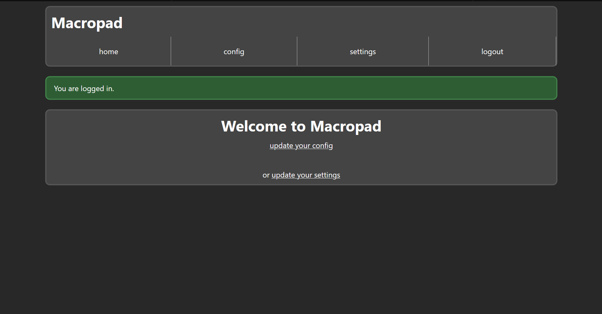
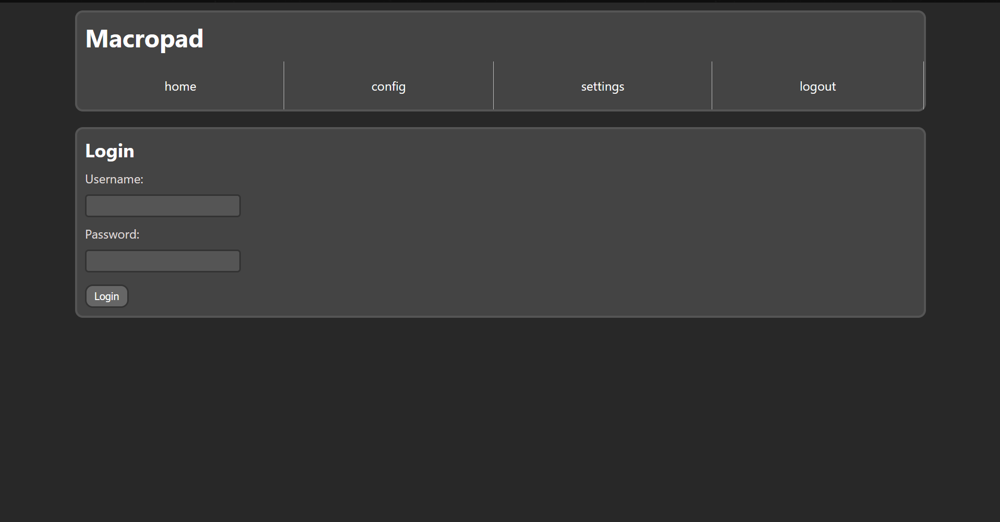
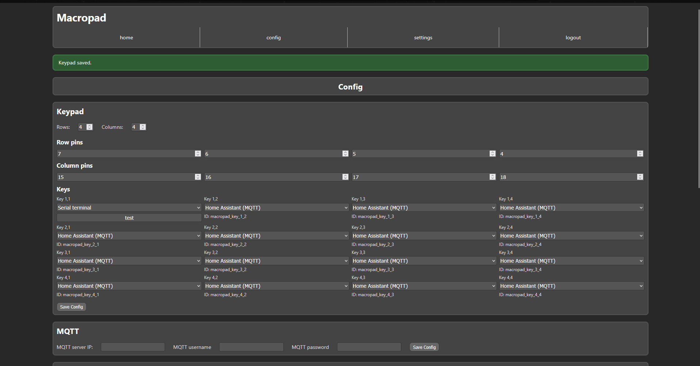
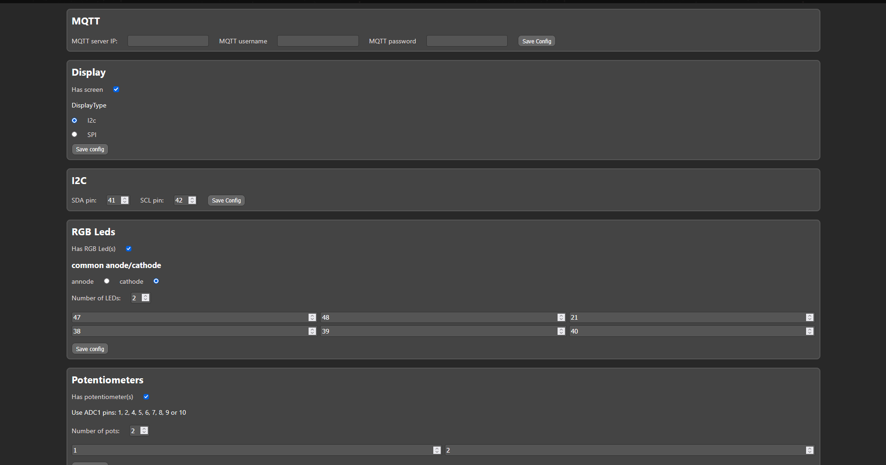
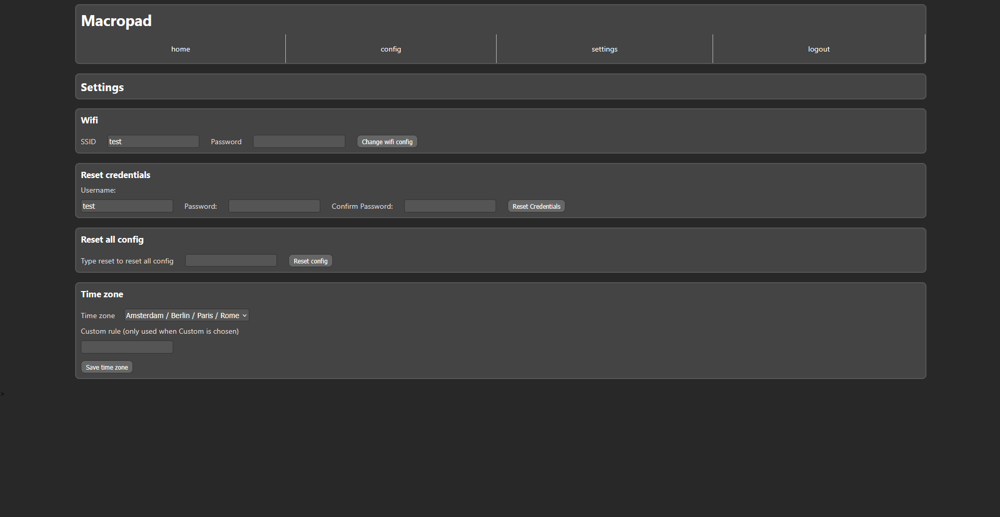
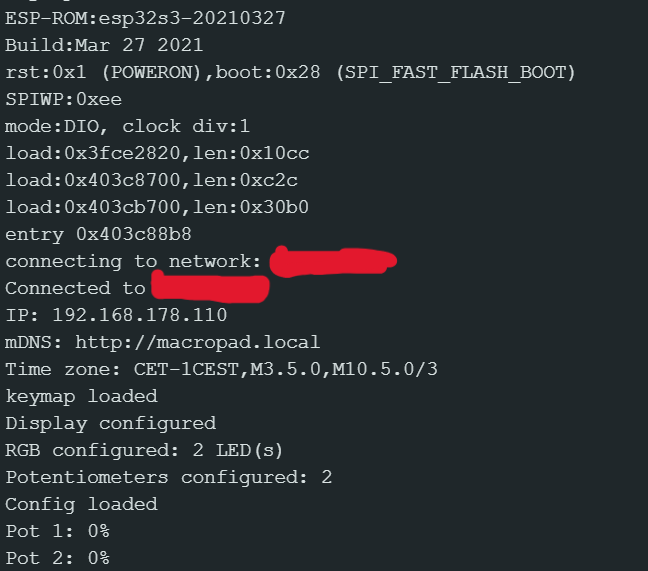

# Macropad esp32s3 software
A esp32 program that is made for macropad, its easy to install via arduino ide. The idea to make this came for <a href="https://github.com/DaanMB/Macropad-HA">this project</a> , since there were a few anoying things in espHome like buttons activating while nothing was clicked, but then i got the idea to make it a lot more custimisable. So now it will support a lot more configurations.

# How to use
1. In your arduinoide install the esp32 library and the libraries: PubSubClient, Keypad, Adafruit GFX and Adafruit SSD1306. Then select your exact board and port and go to Tools -> USB-Mode and select USB-OTG(tinyusb)
2. After you install it on your esp32 S3 you will have to connect to it via wifi to set your home wifi network, you need to connect to a network named: "ESP32-Setup", there you can put in your SSID and if you have one your password.
3. Then it will restart and after restarting you need to be on the network you just configured it to and register. This will be stored on the esp32 itself.
4. You need to log in and then you can go to the config page to set your configuration for your macropad, the parts that are supported are at the moment: an matrix of buttons, an i2c or spi 64x128 screen, rgb leds with a common cathode or annode and potentiometors.
5. You can set your timezone in the settings menu and you can also put in another wifi setup or login and reset the whole config.

# Media
<a href="https://www.youtube.com/watch?v=aJwLciSTP1M">Here is a video showing the project</a>

